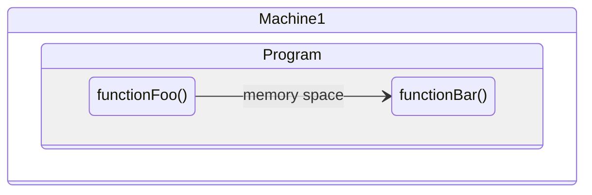
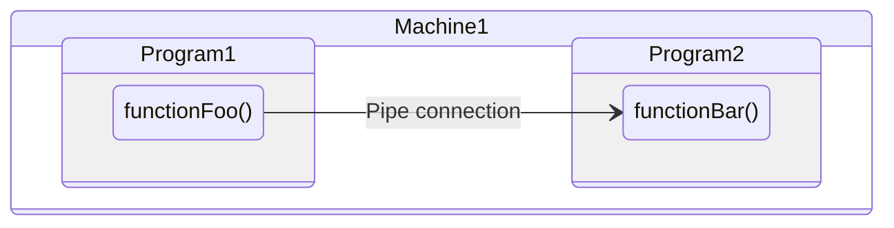
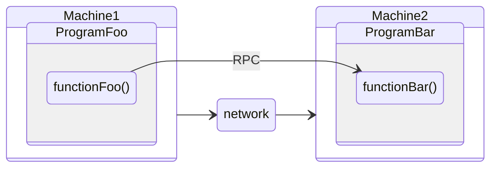

I originally wrote this back in 2024 when I started working with(for)
Google in 2023 where I dealt with this technology extensively but
didn't get around publishing this post until recently (this being 2026).
In fact this is my first public blog post in quite a while :) the last
one was in 2021.

# In This Post

1. [What's gRPC?](#grpc)
2. [How to create a gRPC based service.](#grpc-service-implementation)
3. [Numbers: Comparison of gRPC and RESTful service.](#grpc-vs-rest-api)
4. [Theory: How does binary encoding work?](#grpc-encoding-and-decoding)
5. [Practical application for network engineers.](#grpc-applications)


# gRPC

By definition, gRPC is an open-source framework developed by Google that allows
for remote procedure calls (RPC) using HTTP/2. That is, data is transferred
in HTTP/2 frames (which is not to be confused with layer 2 Ethernet frames).
HTTP/2 frames are used at the application layer.

In simpler terms, gRPC allows you to call a function "remotely" over the
network, hence the name, "remote procedure". Basically, you define a function
which acts as an endpoint and when the RPC for that endpoint is called it
will execute the function and return the results to the caller. The function
lives in some gRPC stub server and it is invoked thru a gRPC stub client.
If all that sounds confusing it will be clearer in a moment, kindly read on.

In typical setups all your source code lives/runs on the same machine. During
development you just locally import the functions/classes you need from
different modules in your code base. In that conventional setup all the
modules and packages are locally available on your machine. This means when
the code is deployed to run as an application its functions communicate
in-memory of your computer. Each function is loaded into memory and can be
called via that memory reference within the same machine.

Imagine a world where your code base is broken down into smaller, independent
functional units called microservices, each running on different machines,
VMs, or containers. This means instead of all your functions from different
packages/modules being loaded into memory and communicate internally as part
of the same application, you will have the communication between them
happening over a network connection. Simply put instead of having functions
calling each other in memory gRPC provides a framework for functions from
different modules (or services) to be called over a network connection.

Say we have a program that has 2 functions; *functionFoo* and *functionBar*.
When *functionFoo* calls *functionBar*, that execution happen in memory of
the machine in the call stack using pointers/memory addresses as both
functions are likely to be running within the same process that is executing
the program.



If the functions were in different programs within the same machine, the
communication would happen via Inter-Process Communication (IPC) using
mechanism such as; signals, message queues or pipes.



With RPCs we bring about the idea that these 2 functions can live in different
machines and they can call each other via RPC over a routed network connection
using routing/IP addresses. Similar to a browser establishing a session to
access a website URL, essentially the RESTful API fashion.



# gRPC service implementation

gRPC operates in client/server model. The code for the client and server is
often generated using grpc tools. I say "often" because you can actually
implement it yourself though I don't see why you would want to hustle yourself
like that. We'll see this later on under [this section](#go-server)

> With the use of grpc tools and a [proto](#proto-file) file we will create
> the grpc server and client classes that handle data serialization and RPC
> communication. This auto generated code will be used when developing the
> server and client modules for the service.

## Setting things up

gRPC applications use Protocol Buffers (protobuf for short) files for
service definitions and data serialization. The proto itself is language
agnostic, that is, the proto file can be used to generate server and
client code for any programming language of choice.

> The `protoc` tool is the Protocol Buffer Compiler. It's used to compile
> `.proto` files, which contain service and message definitions, into
> source code in various programming language.

For python the following module is necessary.

```shell
pip install grpcio-tools
```

For other languages like Go you will need `proto` compiler, this can be
downloaded from [grpc.io](https://grpc.io/docs/protoc-installation/)

Using this tool the RPC server and its corresponding client code is
generated from the proto file(s) which basically defines what the service
will look like and what RPC endpoints the server will be listening to.


## Proto file

A `.proto` **file** is a **Protocol Buffers (protobuf) file** used to define
structured data formats. It defines; the **Service**, its APIs (**RPCs**)
and data structures (**messages**) used by the APIs.

Let's walk-through a typical "hello world!" example. The file `hello.proto`
below defines a service called `Greeter` which implements the method
`SayHello`.

```proto
syntax = "proto3";
package hello;

// The greeting service definition.
service Greeter {
  // RCP endpoint that sends a greeting
  rpc SayHello (HelloRequest) returns (HelloReply) {}
}

// The request message containing the user's name.
message HelloRequest {
  string name = 1;
}

// The response message containing the greetings
message HelloReply {
  string message = 1;
}
```

We use the proto file to generate a protobuf library for the programming
language of choice, example below using python.

```shell
basondole% protoc --python_out=. hello.proto --grpc_python_out=.
'protoc-gen-grpc_python' is not recognized as an internal or external command,
operable program or batch file.
--grpc_python_out: protoc-gen-grpc_python: Plugin failed with status code 1.
```

Note: In the above the `protoc` compiler doesn't work for python, so we use a
python module instead. More on this behaviour
[here](https://stackoverflow.com/questions/62649353/difference-between-protoc-and-python-m-grpc-tools-protoc).

```shell
basondole% pip install grpcio-tools

basondole% ls hello*
hello.proto

basondole% python -m grpc_tools.protoc --proto_path=. --python_out=. --grpc_python_out=. hello.proto

basondole% ls hello*
hello.proto  hello_pb2.py  hello_pb2_grpc.py
basondole%
```

Two new files have been generated:
1. `hello_pb2.py`
This file contains the Python classes for the messages defined in the
`hello.proto` file. That is, it handles the data structures and serialization.
It includes serialization and deserialization methods for these message types.
2. `hello_pb2_grpc.py`
This file contains the gRPC client and server classes.
It includes stub classes for the client and service classes for the server
that handles the RPC communication layer.


## Server and client code

We write code for the server and use the `pb` file generated previously as
our imports.

## Python implementation

### Server

```python
# server.py
from concurrent import futures
import time

import grpc
import hello_pb2
import hello_pb2_grpc


# Implementing the Greeter service defined in the proto
class Greeter(hello_pb2_grpc.GreeterServicer):

    def SayHello(self, request, context):
        print(f"Received: {request.name}")
        return hello_pb2.HelloReply(message="Hello, {}".format(request.name))


def serve():
    server = grpc.server(futures.ThreadPoolExecutor(max_workers=10))
    hello_pb2_grpc.add_GreeterServicer_to_server(Greeter(), server)
    server.add_insecure_port("[::]:50051")
    server.start()
    print("Server is running on port 50051...")
    try:
        while True:
            time.sleep(86400)  # Keep the server running
    except KeyboardInterrupt:
        server.stop(0)


if __name__ == "__main__":
    serve()
```

Start the server so it listens to incoming requests.

```shell
basondole% python ./hello_server.py
Server is running on port 50051...

```

### Client

```python
# client.py
import grpc

import hello_pb2
import hello_pb2_grpc


def run():
    with grpc.insecure_channel("localhost:50051") as channel:
        stub = hello_pb2_grpc.GreeterStub(channel)
        request = hello_pb2.HelloRequest(name="PyWorld")
        response = stub.SayHello(request)
        print("Greeter client received: " + response.message)


if __name__ == "__main__":
    run()
```

On a separate window, run the client.

```shell
basondole% python ./hello_client.py
Greeter client received: Hello, PyWorld
```

On the window where `service.py` is running you will see `Received: PyWorld`
which is the name set in the request sent by the client above.

```shell
basondole% python ./hello_server.py
Server is running on port 50051...
Received: PyWorld
```

### gRPC Request pcap

The entire HTTP data stream below is **660** *bytes*, on the headers portion
we can see `user-agent grpc-python`.

> In the output below the indented parts are the responses from the server,
> also note the packet's content is in plain text. This is because the
> example used here is using an insecure channel. The server and client can
> be configured to use TLS for transport encryption and per RPC
> authentication/authorization with username and password or other
> authorization methods such as web tokens etc.

```
00000000  50 52 49 20 2a 20 48 54  54 50 2f 32 2e 30 0d 0a   PRI * HT TP/2.0..
00000010  0d 0a 53 4d 0d 0a 0d 0a  00 00 24 04 00 00 00 00   ..SM.... ..$.....
00000020  00 00 02 00 00 00 00 00  03 7f ff ff ff 00 04 00   ........ ........
00000030  40 00 00 00 05 00 40 00  00 00 06 00 00 40 00 fe   @.....@. .....@..
00000040  03 00 00 00 01 00 00 04  08 00 00 00 00 00 00 3f   ........ .......?
00000050  00 01                                              ..
    00000000  00 00 18 04 00 00 00 00  00 00 04 00 40 00 00 00   ........ ....@...
    00000010  05 00 40 00 00 00 06 00  00 40 00 fe 03 00 00 00   ..@..... .@......
    00000020  01 00 00 04 08 00 00 00  00 00 00 3f 00 01         ........ ...?..
    0000002E  00 00 00 04 01 00 00 00  00                        ........ .
00000052  00 00 00 04 01 00 00 00  00 00 00 db 01 04 00 00   ........ ........
00000062  00 01 40 05 3a 70 61 74  68 17 2f 68 65 6c 6c 6f   ..@.:pat h./hello
00000072  2e 47 72 65 65 74 65 72  2f 53 61 79 48 65 6c 6c   .Greeter /SayHell
00000082  6f 40 0a 3a 61 75 74 68  6f 72 69 74 79 14 31 39   o@.:auth ority.19
00000092  32 2e 31 36 38 2e 38 30  2e 31 35 35 3a 35 30 30   2.168.80 .155:500
000000A2  35 31 83 86 40 0c 63 6f  6e 74 65 6e 74 2d 74 79   51..@.co ntent-ty
000000B2  70 65 10 61 70 70 6c 69  63 61 74 69 6f 6e 2f 67   pe.appli cation/g
000000C2  72 70 63 40 02 74 65 08  74 72 61 69 6c 65 72 73   rpc@.te. trailers
000000D2  40 14 67 72 70 63 2d 61  63 63 65 70 74 2d 65 6e   @.grpc-a ccept-en
000000E2  63 6f 64 69 6e 67 17 69  64 65 6e 74 69 74 79 2c   coding.i dentity,
000000F2  20 64 65 66 6c 61 74 65  2c 20 67 7a 69 70 40 0a    deflate , gzip@.
00000102  75 73 65 72 2d 61 67 65  6e 74 32 67 72 70 63 2d   user-age nt2grpc-
00000112  70 79 74 68 6f 6e 2f 31  2e 36 35 2e 34 20 67 72   python/1 .65.4 gr
00000122  70 63 2d 63 2f 34 32 2e  30 2e 30 20 28 77 69 6e   pc-c/42. 0.0 (win
00000132  64 6f 77 73 3b 20 63 68  74 74 70 32 29 00 00 04   dows; ch ttp2)...
00000142  08 00 00 00 00 01 00 00  00 05 00 00 0e 00 01 00   ........ ........
00000152  00 00 01 00 00 00 00 09  0a 07 50 79 57 6f 72 6c   ........ ..PyWorl
00000162  64 00 00 04 08 00 00 00  00 00 00 00 00 05         d....... ......
    00000037  00 00 08 06 00 00 00 00  00 ab da 59 be c1 4f fc   ........ ...Y..O.
    00000047  21                                                 !
00000170  00 00 08 06 01 00 00 00  00 ab da 59 be c1 4f fc   ........ ...Y..O.
00000180  21                                                 !
    00000048  00 00 4e 01 04 00 00 00  01 88 40 0c 63 6f 6e 74   ..N..... ..@.cont
    00000058  65 6e 74 2d 74 79 70 65  10 61 70 70 6c 69 63 61   ent-type .applica
    00000068  74 69 6f 6e 2f 67 72 70  63 40 14 67 72 70 63 2d   tion/grp c@.grpc-
    00000078  61 63 63 65 70 74 2d 65  6e 63 6f 64 69 6e 67 17   accept-e ncoding.
    00000088  69 64 65 6e 74 69 74 79  2c 20 64 65 66 6c 61 74   identity , deflat
    00000098  65 2c 20 67 7a 69 70 00  00 15 00 00 00 00 00 01   e, gzip. ........
    000000A8  00 00 00 00 10 0a 0e 48  65 6c 6c 6f 2c 20 50 79   .......H ello, Py
    000000B8  57 6f 72 6c 64 00 00 1e  01 05 00 00 00 01 40 0b   World... ......@.
    000000C8  67 72 70 63 2d 73 74 61  74 75 73 01 30 00 0c 67   grpc-sta tus.0..g
    000000D8  72 70 63 2d 6d 65 73 73  61 67 65 00 00 00 04 08   rpc-mess age.....
    000000E8  00 00 00 00 00 00 00 00  0e                        ........ .
00000181  00 00 08 06 00 00 00 00  00 da 00 13 89 62 89 74   ........ .....b.t
00000191  40                                                 @
    000000F1  00 00 08 06 01 00 00 00  00 da 00 13 89 62 89 74   ........ .....b.t
    00000101  40                                                 @
```

**TCP stream conversation details**

```json
[
    {
        "Address A": "192.168.80.1",
        "Address B": "192.168.80.155",
        "Bits/s A → B": "396912",
        "Bits/s B → A": "314884",
        "Bytes": "1614",
        "Bytes A → B": "900",
        "Bytes B → A": "714",
        "Duration": "0.018139999999999823",
        "Packets": "17",
        "Packets A → B": "9",
        "Packets B → A": "8",
        "Percent Filtered": "65.38",
        "Port A": "64334",
        "Port B": "50051",
        "Rel Start": "1.588032",
        "Stream ID": "0",
        "Total Packets": "26"
    }
]
```


HTTP/2 stream, excluding TCP stuff i.e, excluding SYN, ACK, FIN.
```json
[
    {
        "Address A": "192.168.80.1",
        "Address B": "192.168.80.155",
        "Bits/s A → B": "272546",
        "Bits/s B → A": "232855",
        "Bytes": "1146",
        "Bytes A → B": "618",
        "Bytes B → A": "528",
        "Duration": "0.018139999999999823",
        "Packets": "9",
        "Packets A → B": "4",
        "Packets B → A": "5",
        "Percent Filtered": "34.62",
        "Port A": "64334",
        "Port B": "50051",
        "Rel Start": "1.588032",
        "Stream ID": "0",
        "Total Packets": "26"
    }
]
```


**HTTP/2 frame count with Python client**

> Frame count is not to be confused with packet count, a single packet can have
multiple HTTP/2 frames of different types.

```
================================================================================================================================
HTTP2:
Topic / Item     Count         Average       Min Val       Max Val       Rate (ms)     Percent       Burst Rate    Burst Start  
--------------------------------------------------------------------------------------------------------------------------------
HTTP2            18                                                      6.2155        100%          0.1800        1.602        
 Type            18                                                      6.2155        100.00%       0.1800        1.602        
  WINDOW_UPDATE  5                                                       1.7265        27.78%        0.0500        1.602        
  SETTINGS       4                                                       1.3812        22.22%        0.0400        1.602        
  PING           4                                                       1.3812        22.22%        0.0400        1.604        
  HEADERS        3                                                       1.0359        16.67%        0.0300        1.603        
  DATA           2                                                       0.6906        11.11%        0.0200        1.603        

--------------------------------------------------------------------------------------------------------------------------------
```


## GoLang implementation

As fore mentioned the proto file is language agnostic, gRPC services defined by
it can be implemented by any client i.e., a client written in any language.
We'll create a Go client next.

First we create a directory and the proto buffers files for golang. Similar to 
python, this will generate 2 files:

1. `hello.pb.go`
2. `hello_grpc.pb.go`

```shell
basondole% pwd
/home/user/go
basondole% ls
hello.proto

basondole% mkdir hello

basondole% protoc --go_out=hello --go-grpc_out=hello hello.proto  

basondole% ls hello/
hello.pb.go  hello_grpc.pb.go

basondole% go mod init my-package

basondole% go get google.golang.org/grpc 

basondole% ls
hello   hello.proto   hello_client.go
```

### Go client code

```go
// hello_client.go
package main

import (
    "context"
    "log"
    "time"

    "google.golang.org/grpc"
    pb "my-package/hello"
)

func main() {
    conn, err := grpc.Dial("localhost:50051", grpc.WithInsecure(), grpc.WithBlock())
    if err != nil {
        log.Fatalf("did not connect: %v", err)
    }
    defer conn.Close()

    client := pb.NewGreeterClient(conn)

    ctx, cancel := context.WithTimeout(context.Background(), time.Second)
    defer cancel()

    request := &pb.HelloRequest{Name: "GoWorld"}
    response, err := client.SayHello(ctx, request)
    if err != nil {
        log.Fatalf("could not greet: %v", err)
    }
    log.Printf("Greeter client received: %s", response.Message)
}
```

Run the go client.

```shell
basondole% go run ./hello_client.go
2024/12/18 22:02:50 Greeter client received: Hello, GoWorld
```

On the server window where the python based gRPC server is running we see the
message received.

> Note: I didn't spawn a new instance of the server. It is till the same server
terminal so all the previous output is still there.

```sh
basondole% python ./hello_server.py
Server is running on port 50051...
Received: PyWorld
Received: GoWorld
```


HTTP/2 data stream when using Go client.

> In the output below, the indented parts are the responses from the server.

```
00000000  50 52 49 20 2a 20 48 54  54 50 2f 32 2e 30 0d 0a   PRI * HT TP/2.0..
00000010  0d 0a 53 4d 0d 0a 0d 0a                            ..SM.... 
00000018  00 00 00 04 00 00 00 00  00                        ........ .
    00000000  00 00 18 04 00 00 00 00  00 00 04 00 40 00 00 00   ........ ....@...
    00000010  05 00 40 00 00 00 06 00  00 40 00 fe 03 00 00 00   ..@..... .@......
    00000020  01 00 00 04 08 00 00 00  00 00 00 3f 00 01         ........ ...?..
    0000002E  00 00 00 04 01 00 00 00  00                        ........ .
00000021  00 00 00 04 01 00 00 00  00                        ........ .
0000002A  00 00 5c 01 04 00 00 00  01 83 86 45 91 62 72 d1   ..\..... ...E.br.
0000003A  41 d7 c5 61 4a 92 d8 c6  e1 fa c6 5a 28 3f 41 8f   A..aJ... ...Z(?A.
0000004A  0b e2 5c 2e 3c bb c0 5c  2d b7 71 b0 01 b0 ff 5f   ..\.<..\ -.q...._
0000005A  8b 1d 75 d0 62 0d 26 3d  4c 4d 65 64 7a 8a 9a ca   ..u.b.&= LMedz...
0000006A  c8 b4 c7 60 2b b8 fa e2  40 02 74 65 86 4d 83 35   ...`+... @.te.M.5
0000007A  05 b1 1f 40 89 9a ca c8  b2 4d 49 4f 6a 7f 86 08   ...@.... .MIOj...
0000008A  00 00 00 16 ff                                     .....
0000008F  00 00 0e 00 01 00 00 00  01 00 00 00 00 09 0a 07   ........ ........
0000009F  47 6f 57 6f 72 6c 64                               GoWorld
    00000037  00 00 08 06 00 00 00 00  00 c8 4f e6 a0 66 ea 4c   ........ ..O..f.L
    00000047  2d                                                 -
000000A6  00 00 08 06 01 00 00 00  00 c8 4f e6 a0 66 ea 4c   ........ ..O..f.L
000000B6  2d                                                 -
    00000048  00 00 4e 01 04 00 00 00  01 88 40 0c 63 6f 6e 74   ..N..... ..@.cont
    00000058  65 6e 74 2d 74 79 70 65  10 61 70 70 6c 69 63 61   ent-type .applica
    00000068  74 69 6f 6e 2f 67 72 70  63 40 14 67 72 70 63 2d   tion/grp c@.grpc-
    00000078  61 63 63 65 70 74 2d 65  6e 63 6f 64 69 6e 67 17   accept-e ncoding.
    00000088  69 64 65 6e 74 69 74 79  2c 20 64 65 66 6c 61 74   identity , deflat
    00000098  65 2c 20 67 7a 69 70 00  00 15 00 00 00 00 00 01   e, gzip. ........
    000000A8  00 00 00 00 10 0a 0e 48  65 6c 6c 6f 2c 20 47 6f   .......H ello, Go
    000000B8  57 6f 72 6c 64 00 00 1e  01 05 00 00 00 01 40 0b   World... ......@.
    000000C8  67 72 70 63 2d 73 74 61  74 75 73 01 30 00 0c 67   grpc-sta tus.0..g
    000000D8  72 70 63 2d 6d 65 73 73  61 67 65 00 00 00 04 08   rpc-mess age.....
    000000E8  00 00 00 00 00 00 00 00  0e                        ........ .
000000B7  00 00 04 08 00 00 00 00  00 00 00 00 15 00 00 08   ........ ........
000000C7  06 00 00 00 00 00 02 04  10 10 09 0e 07 07         ........ ......
    000000F1  00 00 08 06 01 00 00 00  00 02 04 10 10 09 0e 07   ........ ........
    00000101  07                                                 .
000000D5  00 00 21 07 00 00 00 00  00 00 00 00 01 00 00 00   ..!..... ........
000000E5  00 63 6c 69 65 6e 74 20  74 72 61 6e 73 70 6f 72   .client  transpor
000000F5  74 20 73 68 75 74 64 6f  77 6e                     t shutdo wn
```

**TCP stream details**

> Note: Go client sent more packets than Python client, that is `22 packets`
(*1743 bytes*) versus `17 packets` (*1614 bytes*) and was also slower by
`0.013` seconds (13 ms).

```json
[
    {
        "Address A": "192.168.80.1",
        "Address B": "192.168.80.155",
        "Bits/s A → B": "1797356",
        "Bits/s B → A": "1435659",
        "Bytes": "1743",
        "Bytes A → B": "969",
        "Bytes B → A": "774",
        "Duration": "0.004313000000000011",
        "Packets": "22",
        "Packets A → B": "13",
        "Packets B → A": "9",
        "Percent Filtered": "62.86",
        "Port A": "64283",
        "Port B": "50051",
        "Rel Start": "0.956624",
        "Stream ID": "0",
        "Total Packets": "35"
    }
]
```

HTTP/2 stream, excluding TCP stuff i.e, excluding SYN, ACK, FIN.

```json
[
    {
        "Address A": "192.168.80.1",
        "Address B": "192.168.80.155",
        "Bits/s A → B": "1077224",
        "Bits/s B → A": "827910",
        "Bytes": "1215",
        "Bytes A → B": "687",
        "Bytes B → A": "528",
        "Duration": "0.00510199999999994",
        "Packets": "13",
        "Packets A → B": "8",
        "Packets B → A": "5",
        "Percent Filtered": "35.14",
        "Port A": "65448",
        "Port B": "50051",
        "Rel Start": "7.101586",
        "Stream ID": "0",
        "Total Packets": "37"
    }
]
```


**HTTP/2 frame count with Go client**

> Frame count is not to be confused with packet count, a single packet can have
multiple HTTP/2 frames of different types.

```
================================================================================================================================
HTTP2:
Topic / Item     Count         Average       Min Val       Max Val       Rate (ms)     Percent       Burst Rate    Burst Start  
--------------------------------------------------------------------------------------------------------------------------------
HTTP2            17                                                      4.2341        100%          0.1700        7.102        
 Type            17                                                      4.2341        100.00%       0.1700        7.102        
  WINDOW_UPDATE  3                                                       0.7472        17.65%        0.0300        7.103        
  SETTINGS       4                                                       0.9963        23.53%        0.0400        7.102        
  PING           4                                                       0.9963        23.53%        0.0400        7.105        
  HEADERS        3                                                       0.7472        17.65%        0.0300        7.104        
  GOAWAY         1                                                       0.2491        5.88%         0.0100        7.106        
  DATA           2                                                       0.4981        11.76%        0.0200        7.104        

--------------------------------------------------------------------------------------------------------------------------------
```


The above HTTP/2 stream with a Go client is **513** *bytes* versus the
**660** *bytes* we got using a Python client. The obvious difference between
the 2 hex dumps is that the Python client request hex dump had a bunch of
metadata that's not seen in the Go client stream hex dump. This is because of
header compression
[HPACK](https://medium.com/geekculture/hpack-header-compression-format-for-http-2-155a0b4934f7)

> The HTTP/2 protocol has specific frame types, and the presence of certain
frames e.g., `HEADERS` frames inherently indicates that the headers are `HPACK`
compressed. Since both client and server implement the HTTP/2 protocol, they
have the logic to correctly parse and decompress the headers when they
encounter the `HEADERS` frames.

A little bit of intel on HPACK Encoding:
HPACK uses a static and dynamic table to index header fields. Headers can also
be encoded as literal values, with or without indexing.
- Indexed Headers: Headers that are already in the static or dynamic table.
Only the index is transmitted, leading to higher compression.
- Literal Header Fields: New headers are sent as literal values and may or may
not be added to the dynamic table.

The Python client used the literal value approach that's why we could "see" the
headers in the pcap.


This portion of bytes below is from the Go client hex dump, it didn't show the
headers in a way that we could "read".

```
0000002A  00 00 5c 01 04 00 00 00  01 83 86 45 91 62 72 d1   ..\..... ...E.br.
0000003A  41 d7 c5 61 4a 92 d8 c6  e1 fa c6 5a 28 3f 41 8f   A..aJ... ...Z(?A.
0000004A  0b e2 5c 2e 3c bb c0 5c  2d b7 71 b0 01 b0 ff 5f   ..\.<..\ -.q...._
0000005A  8b 1d 75 d0 62 0d 26 3d  4c 4d 65 64 7a 8a 9a ca   ..u.b.&= LMedz...
0000006A  c8 b4 c7 60 2b b8 fa e2  40 02 74 65 86 4d 83 35   ...`+... @.te.M.5
0000007A  05 b1 1f 40 89 9a ca c8  b2 4d 49 4f 6a 7f 86 08   ...@.... .MIOj...
0000008A  00 00 00 16 ff                                     .....
```

What I may or may not have mentioned is that this byte stream represents the
compressed headers, starting from the 12th byte of the row `0000002A` that is
`45` to the last byte of the row `0000008A` that is `ff`. The actual data needs
to be decompressed using HPACK. When decompressed that stream of bytes becomes:

```
0000   00 00 00 07 3a 6d 65 74 68 6f 64 00 00 00 04 50   ....:method....P
0010   4f 53 54 00 00 00 07 3a 73 63 68 65 6d 65 00 00   OST....:scheme..
0020   00 04 68 74 74 70 00 00 00 05 3a 70 61 74 68 00   ..http....:path.
0030   00 00 17 2f 68 65 6c 6c 6f 2e 47 72 65 65 74 65   .../hello.Greete
0040   72 2f 53 61 79 48 65 6c 6c 6f 00 00 00 0a 3a 61   r/SayHello....:a
0050   75 74 68 6f 72 69 74 79 00 00 00 14 31 39 32 2e   uthority....192.
0060   31 36 38 2e 38 30 2e 31 35 35 3a 35 30 30 35 31   168.80.155:50051
0070   00 00 00 0c 63 6f 6e 74 65 6e 74 2d 74 79 70 65   ....content-type
0080   00 00 00 10 61 70 70 6c 69 63 61 74 69 6f 6e 2f   ....application/
0090   67 72 70 63 00 00 00 0a 75 73 65 72 2d 61 67 65   grpc....user-age
00a0   6e 74 00 00 00 0e 67 72 70 63 2d 67 6f 2f 31 2e   nt....grpc-go/1.
00b0   36 39 2e 32 00 00 00 02 74 65 00 00 00 08 74 72   69.2....te....tr
00c0   61 69 6c 65 72 73 00 00 00 0c 67 72 70 63 2d 74   ailers....grpc-t
00d0   69 6d 65 6f 75 74 00 00 00 08 31 30 30 30 30 30   imeout....100000
00e0   30 75                                             0u
```

> Note: In the above view before decompressing, the offsets are shown in an
8-digit format which is an offset of each line starting from the beginning of
the stream. Wireshark uses 8 digits in order to accommodate large stream.
After decompressing, the offsets are shown in a 4-digit format starting with
`0000` because the count is relative to the segment we are looking at.
The segment it self is `0000002A` relative to the first byte of the stream

Tools like Wireshark have ability to use the HPACK algorithm to decompress
HTTP/2 headers. We can actually use some library to decode HPACK headers.
In Python for example with the `hpack` library

```sh
pip install hpack
```

Creating a hpack decode script `decode.py` using literal bytes from the
previous hex dump.

```python
# decode.py
from hpack import Encoder, Decoder
from pprint import pprint as pp

literal_bytes = (
    "45916272d141d7c5614a92d8c6e1fac65a283f418f0be25"
    "c2e3cbbc05c2db771b001b0ff5f8b1d75d0620d263d4c4d"
    "65647a8a9acac8b4c7602bb8fae240027465864d833505b1"
    "1f40899acac8b24d494f6a7f860800000016ff"
)
d = Decoder()
decoded = d.decode(bytes.fromhex(literal_byte))
pp(decoded)
```

Running the script.

```sh
basondole% python decode.py
[(':path', '/hello.Greeter/SayHello'),
 (':authority', '192.168.80.155:50051'),
 ('content-type', 'application/grpc'),
 ('user-agent', 'grpc-go/1.69.2'),
 ('te', 'trailers'),
 ('grpc-timeout', '1000000u')]
```

Similar to what we saw with the python client we can see the user agent for Go
`user-agent grpc-go/1.69.2` and the other headers that were compressed and
"unreadable" in the original hex dump.


### Go server

For completion sake below is the server written in Go using the protocol buffer
code that we generated [before](#golang-implementation) from the proto file and
stored in `my-package/hello`.

```go
// hello_server.go
package main

import (
    "context"
    "log"
    "net"

    "google.golang.org/grpc"
    pb "my-package/hello" 
)

// server is used to implement hello.GreeterServer
type server struct {
    pb.UnimplementedGreeterServer
}

// SayHello implements hello.GreeterServer
func (s *server) SayHello(ctx context.Context, in *pb.HelloRequest) (*pb.HelloReply, error) {
    println("Received: " + in.Name)
    return &pb.HelloReply{Message: "Hello " + in.Name}, nil
}

func main() {
    lis, err := net.Listen("tcp", ":50051")
    if err != nil {
        log.Fatalf("failed to listen: %v", err)
    }
    s := grpc.NewServer()
    pb.RegisterGreeterServer(s, &server{})
    log.Println("Server is running on port 50051...")
    if err := s.Serve(lis); err != nil {
        log.Fatalf("failed to serve: %v", err)
    }
}
```

What happens behind the scenes with gRPC is the following:

1. Creating the Message:
    The client creates a HelloRequest message:
    `hello_pb2.HelloRequest(name='World')`
2. Serialization:
    When the client calls `stub.SayHello`, gRPC internally serializes the
    `HelloRequest` message to a binary format and handles the HTTP/2
    communication, including the creation and management of headers.
3. Sending the Request:
    The serialized binary data is sent over the network using HTTP/2


**Question**

In gRPC, when you send a request to the server how does the server know which
RPC endpoint the request is for?

>The service knows which RPC the request is for because the client specifies
the method name in the request similar to a web URL, and the server routes it
accordingly. The method name is not part of the message serialization itself.
Instead, it's included in the gRPC protocol's metadata.

gRPC uses HTTP/2 as its transport protocol. The method name is sent as part of
the HTTP/2 headers we saw before, specifically in a pseudo-header called
`:path`. The method name is formatted as: `/{service name}/{method name}` for
the `SayHello` method in the `Greeter` service, the path would look like this:
`/hello.Greeter/SayHello`. This path is sent in the HTTP/2 headers, not in the
serialized message body.

A complete gRPC request would include:
- HTTP/2 headers including the method path
- The serialized message body

gRPC handles a lot of this internally but we can actually explicitly serialize
the data and manage the headers without using the generated proto buffer
classes. Not that you'd ever want to do that, but it is possible nonetheless.
See the following example;

> Note: We are using `httpx` instead of the defacto `requests` library because
gRPC uses HTTP/2 transport. The `requests` library is HTTP/1.1 it will not work

```sh
basondole% pip install "httpx[http2]"
```

Let's write some code for our new client without using auto generated code.
Note, this is only the client part the server itself is still running with the
gRPC code we generated earlier.

```python
# explicit_hello_client.py
import httpx

def main():
    # define the data to add to the name field of HelloRequest message
    name = "ExplicitWorld"
    serialized_data = make_wire_format(name.encode())
    # create the HTTP headers, gRPC uses trailing headers (a HTTP feature)
    # see the pcap for the grpc request in above sections to see the headers
    headers = {
        "content-type": "application/grpc",
        "te": "trailers", 
    }
    # configure the client to use HTTP/2
    client = httpx.Client(http1=False, http2=True)
    # send a POST request to the SayHello endpoint
    response = client.post(
        "http://localhost:50051/hello.Greeter/SayHello",
        headers=headers,
        content=serialized_data, # b'\x00\x00\x00\x00\x0f\x0a\x0dExplicitWorld'
    )
    # deserialize the response b'\x00\x00\x00\x00\x15\n\x13Hello ExplicitWorld'
    response_data = response.content
    # ignore the compression byte, length prefix, tag byte and length byte
    data = response_data[7:]
    print(f"Greeter client received: {data.decode()}")


# the wire format of gRPC consists of more than just plain HelloRequest message,
# that request gets encapsulated in an actual ProtoBuf message
# let's get creative and manually craft the required bytes according to 
# gRPC specification https://protobuf.dev/programming-guides/encoding/
def make_wire_format(s: bytes) -> bytes:
    # length of the data in big-endian byte order
    data_length = len(s).to_bytes(1, byteorder='big')
    # the HelloRequest message specifies only a single field, make the 
    # equivalent tag byte that includes the field number and the wire type
    tag = b"\x0a" 
    # the combined length of data and tag to bytes (4 bytes for the length)
    length_prefix = len(tag + data_length + s).to_bytes(4, byteorder='big')
    # compression algorithm byte, 0 for no compression
    compression = b"\x00"
    return compression + length_prefix + tag + data_length + s

if __name__ == '__main__':
    main()
```

Running the code.

```sh
basondole% python ./explicit_hello_client.py
Greeter client received: Hello, ExplicitWorld
```

On the server terminal we see the received name `ExplicitWorld` that we
manually crafted without the gRPC auto generated classes.

> Note: I didn't spawn a new instance of the server. It is till the same server
terminal so all the previous output is still there.

```sh
Server is running on port 50051...
Received: PyWorld
Received: GoWorld
Received: ExplicitWorld
```

The entire HTTP/2 stream with this method is **503** *bytes*, the request is
much lighter compared to the request when using the Python protocol buffers but
is identical to what we saw with Go protocol buffers.

```
00000000  50 52 49 20 2a 20 48 54  54 50 2f 32 2e 30 0d 0a   PRI * HT TP/2.0..
00000010  0d 0a 53 4d 0d 0a 0d 0a  00 00 24 04 00 00 00 00   ..SM.... ..$.....
00000020  00 00 01 00 00 10 00 00  02 00 00 00 00 00 04 00   ........ ........
00000030  00 ff ff 00 05 00 00 40  00 00 03 00 00 00 64 00   .......@ ......d.
00000040  06 00 01 00 00 00 00 04  08 00 00 00 00 00 01 00   ........ ........
00000050  00 00                                              ..
00000052  00 00 58 01 04 00 00 00  01 83 41 8f 0b e2 5c 2e   ..X..... ..A...\.
00000062  3c bb c0 5c 2d b7 71 b0  01 b0 ff 86 44 91 62 72   <..\-.q. ....D.br
00000072  d1 41 d7 c5 61 4a 92 d8  c6 e1 fa c6 5a 28 3f 53   .A..aJ.. ....Z(?S
00000082  83 f9 63 e7 90 7a 8e af  d2 67 3d 4b 4e 94 d7 e5   ..c..z.. .g=KN...
00000092  80 2e 27 97 0f 5f 8b 1d  75 d0 62 0d 26 3d 4c 4d   ..'.._.. u.b.&=LM
000000A2  65 64 40 82 49 7f 86 4d  83 35 05 b1 1f 5c 82 10   ed@.I..M .5...\..
000000B2  3f 00 00 04 08 00 00 00  00 01 01 00 00 00         ?....... ......
000000C0  00 00 14 00 00 00 00 00  01 00 00 00 00 0f 0a 0d   ........ ........
000000D0  45 78 70 6c 69 63 69 74  57 6f 72 6c 64            Explicit World
000000DD  00 00 00 00 01 00 00 00  01                        ........ .
    00000000  00 00 18 04 00 00 00 00  00 00 04 00 40 00 00 00   ........ ....@...
    00000010  05 00 40 00 00 00 06 00  00 40 00 fe 03 00 00 00   ..@..... .@......
    00000020  01 00 00 04 08 00 00 00  00 00 00 3f 00 01         ........ ...?..
    0000002E  00 00 00 04 01 00 00 00  00 00 00 04 08 00 00 00   ........ ........
    0000003E  00 00 00 00 00 14 00 00  08 06 00 00 00 00 00 a8   ........ ........
    0000004E  ae 9c 38 0a 71 2d 3d                               ..8.q-=
000000E6  00 00 00 04 01 00 00 00  00                        ........ .
000000EF  00 00 08 06 01 00 00 00  00 a8 ae 9c 38 0a 71 2d   ........ ....8.q-
000000FF  3d                                                 =
    00000055  00 00 4e 01 04 00 00 00  01 88 40 0c 63 6f 6e 74   ..N..... ..@.cont
    00000065  65 6e 74 2d 74 79 70 65  10 61 70 70 6c 69 63 61   ent-type .applica
    00000075  74 69 6f 6e 2f 67 72 70  63 40 14 67 72 70 63 2d   tion/grp c@.grpc-
    00000085  61 63 63 65 70 74 2d 65  6e 63 6f 64 69 6e 67 17   accept-e ncoding.
    00000095  69 64 65 6e 74 69 74 79  2c 20 64 65 66 6c 61 74   identity , deflat
    000000A5  65 2c 20 67 7a 69 70 00  00 1b 00 00 00 00 00 01   e, gzip. ........
    000000B5  00 00 00 00 16 0a 14 48  65 6c 6c 6f 2c 20 45 78   .......H ello, Ex
    000000C5  70 6c 69 63 69 74 57 6f  72 6c 64 00 00 1e 01 05   plicitWo rld.....
    000000D5  00 00 00 01 40 0b 67 72  70 63 2d 73 74 61 74 75   ....@.gr pc-statu
    000000E5  73 01 30 00 0c 67 72 70  63 2d 6d 65 73 73 61 67   s.0..grp c-messag
    000000F5  65 00                                              e.
```


TCP stream details from pcap analysis.

```json
[
    {
        "Address A": "192.168.80.1",
        "Address B": "192.168.80.155",
        "Bits/s A → B": "525009",
        "Bits/s B → A": "431823",
        "Bytes": "1571",
        "Bytes A → B": "862",
        "Bytes B → A": "709",
        "Duration": "0.013135000000000008",
        "Packets": "19",
        "Packets A → B": "11",
        "Packets B → A": "8",
        "Percent Filtered": "63.33",
        "Port A": "64074",
        "Port B": "50051",
        "Rel Start": "0.830825",
        "Stream ID": "0",
        "Total Packets": "30"
    }
]
```


## gRPC vs REST API

The above service we implemented using gRPC can be implemented in RESTful fashion
with regular HTTP request as follows:

### Server code

```python
# server.py
from flask import (
    Flask,
    request,
    jsonify,
)

app = Flask(__name__)

@app.route("/sayHello", methods=["POST"])
def say_hello():
    # Mimic the HelloRequest message containing the name field
    data = request.json
    name = data.get("name", str())
    print(f"Received: {name}")
    # Mimic the HelloReply message containing the greeting message
    return jsonify({"message": f"Hello, {name}!"})

if __name__ == "__main__":
    app.run()
```

Running the server.

```shell
basondole% python ./server.py
 * Serving Flask app 'server'
 * Debug mode: off
WARNING: This is a development server. Do not use it in a production deployment. Use a production WSGI server instead.
 * Running on http://127.0.0.1:5000
Press CTRL+C to quit

```

### Client code

```python
# client.py
import requests
import json

def run():
    # The data dictionary is similar to HelloRequest containing the name field
    data = {"name": "RESTWorld"}
    # Explicitly serialize data to JSON string
    json_data = json.dumps(data)
    # Send the JSON payload (UTF-8 encoded by default)
    response = requests.post(
        "http://localhost:5000/sayHello",
        data=json_data,
        headers={"Content-Type": "application/json"}
    )
    # Decode and deserialize JSON response
    response_data = response.json()
    print(f"Greeter client received: {response_data['message']}")

if __name__ == "__main__":
    run()
```

Running the client.

```sh
basondole% python ./client.py
Greeter client received: Hello, RESTWorld!
```

On the server terminal we see a POST request received `RESTWorld`.

```sh
basondole% python ./server.py
 * Serving Flask app 'server'
 * Debug mode: off
WARNING: This is a development server. Do not use it in a production deployment. Use a production WSGI server instead.
 * Running on http://127.0.0.1:5000
Press CTRL+C to quit
Received: RESTWorld
127.0.0.1 - - [19/Dec/2024 18:45:19] "POST /sayHello HTTP/1.1" 200 -
```

What happens behind the scenes with REST API is the following;

1. HTTP Headers Creation:
    Headers are created as a dictionary:
    `headers = {'Content-Type': 'application/json'}`
    This dictionary object is then serialized into a text format with key-value
    pairs separated by colons.
2. Payload Serialization:
    Data is serialized to a JSON string: `json_data = json.dumps(data)`
    The JSON string remains in text format initially.
3. Conversion to Bytes:
    The `requests.post()` function internally handles the conversion of the
    entire HTTP request (headers + payload) into bytes.
    Headers (key-value text) are joined with the appropriate CRLF separators
    and encoded as UTF-8 bytes.
    The payload (JSON string) is also encoded as UTF-8 bytes.
    The combined byte sequence representing the full HTTP request is then sent
    over the network.

> CRLF stands for Carriage Return 
(represented as `\r` or ASCII code 13 or `\x0d`) and
Line Feed (represented as `\n` or ASCII code 10 or `\x0a`). Together, they are
used as a line terminator in many text protocols and formats.
- CR: Moves the cursor to the beginning of the line without advancing to the
next line.
- LF: Moves the cursor down to the next line without returning to the
beginning of the line.
Many protocols, such as HTTP, SMTP, and FTP, specify CRLF as the line
terminator for headers and commands. For example, HTTP headers are separated by
CRLF sequences. When crafting HTTP headers, each header line ends with a CRLF
sequence, example below:
```
GET /index.html HTTP/1.1\r\n
Host: www.example.com\r\n
Connection: close\r\n
\r\n
```


HTTP/1.1 data stream is **430** *bytes*.

```
00000000  50 4f 53 54 20 2f 73 61  79 48 65 6c 6c 6f 20 48   POST /sa yHello H
00000010  54 54 50 2f 31 2e 31 0d  0a 48 6f 73 74 3a 20 31   TTP/1.1. .Host: 1
00000020  39 32 2e 31 36 38 2e 38  30 2e 31 35 35 3a 35 30   92.168.8 0.155:50
00000030  30 30 0d 0a 55 73 65 72  2d 41 67 65 6e 74 3a 20   00..User -Agent: 
00000040  70 79 74 68 6f 6e 2d 72  65 71 75 65 73 74 73 2f   python-r equests/
00000050  32 2e 33 32 2e 33 0d 0a  41 63 63 65 70 74 2d 45   2.32.3.. Accept-E
00000060  6e 63 6f 64 69 6e 67 3a  20 67 7a 69 70 2c 20 64   ncoding:  gzip, d
00000070  65 66 6c 61 74 65 0d 0a  41 63 63 65 70 74 3a 20   eflate.. Accept: 
00000080  2a 2f 2a 0d 0a 43 6f 6e  6e 65 63 74 69 6f 6e 3a   */*..Con nection:
00000090  20 6b 65 65 70 2d 61 6c  69 76 65 0d 0a 43 6f 6e    keep-al ive..Con
000000A0  74 65 6e 74 2d 54 79 70  65 3a 20 61 70 70 6c 69   tent-Typ e: appli
000000B0  63 61 74 69 6f 6e 2f 6a  73 6f 6e 0d 0a 43 6f 6e   cation/j son..Con
000000C0  74 65 6e 74 2d 4c 65 6e  67 74 68 3a 20 32 31 0d   tent-Len gth: 21.
000000D0  0a 0d 0a                                           ...
000000D3  7b 22 6e 61 6d 65 22 3a  20 22 52 45 53 54 57 6f   {"name":  "RESTWo
000000E3  72 6c 64 22 7d                                     rld"}
    00000000  48 54 54 50 2f 31 2e 31  20 32 30 30 20 4f 4b 0d   HTTP/1.1  200 OK.
    00000010  0a 53 65 72 76 65 72 3a  20 57 65 72 6b 7a 65 75   .Server:  Werkzeu
    00000020  67 2f 33 2e 31 2e 33 20  50 79 74 68 6f 6e 2f 33   g/3.1.3  Python/3
    00000030  2e 31 30 2e 31 32 0d 0a  44 61 74 65 3a 20 46 72   .10.12.. Date: Fr
    00000040  69 2c 20 32 30 20 44 65  63 20 32 30 32 34 20 31   i, 20 De c 2024 1
    00000050  35 3a 33 33 3a 33 32 20  47 4d 54 0d 0a 43 6f 6e   5:33:32  GMT..Con
    00000060  74 65 6e 74 2d 54 79 70  65 3a 20 61 70 70 6c 69   tent-Typ e: appli
    00000070  63 61 74 69 6f 6e 2f 6a  73 6f 6e 0d 0a 43 6f 6e   cation/j son..Con
    00000080  74 65 6e 74 2d 4c 65 6e  67 74 68 3a 20 33 32 0d   tent-Len gth: 32.
    00000090  0a 43 6f 6e 6e 65 63 74  69 6f 6e 3a 20 63 6c 6f   .Connect ion: clo
    000000A0  73 65 0d 0a 0d 0a                                  se....
    000000A6  7b 22 6d 65 73 73 61 67  65 22 3a 22 48 65 6c 6c   {"messag e":"Hell
    000000B6  6f 2c 20 52 45 53 54 57  6f 72 6c 64 21 22 7d 0a   o, RESTW orld!"}.
```

TCP stream details.

```json
[
    {
        "Address A": "192.168.80.1",
        "Address B": "192.168.80.155",
        "Bits/s A → B": "352877",
        "Bits/s B → A": "342937",
        "Bytes": "1120",
        "Bytes A → B": "568",
        "Bytes B → A": "552",
        "Duration": "0.012876999999988925",
        "Packets": "12",
        "Packets A → B": "6",
        "Packets B → A": "6",
        "Percent Filtered": "66.67",
        "Port A": "63592",
        "Port B": "5000",
        "Rel Start": "82.46768900000001",
        "Stream ID": "0",
        "Total Packets": "18"
    }
]
```


HTTP/1.1 frame count analysis.

```
=======================================================================================================================================
HTTP/Packet Counter:
Topic / Item            Count         Average       Min Val       Max Val       Rate (ms)     Percent       Burst Rate    Burst Start  
---------------------------------------------------------------------------------------------------------------------------------------
Total HTTP Packets      4                                                       0.3132        100%          0.0400        3.537        
 Other HTTP Packets     2                                                       0.1566        50.00%        0.0200        3.537        
 HTTP Response Packets  1                                                       0.0783        25.00%        0.0100        3.538        
  ???: broken           0                                                       0.0000        0.00%         -             -            
  5xx: Server Error     0                                                       0.0000        0.00%         -             -            
  4xx: Client Error     0                                                       0.0000        0.00%         -             -            
  3xx: Redirection      0                                                       0.0000        0.00%         -             -            
  2xx: Success          1                                                       0.0783        100.00%       0.0100        3.538        
   200 OK               1                                                       0.0783        100.00%       0.0100        3.538        
  1xx: Informational    0                                                       0.0000        0.00%         -             -            
 HTTP Request Packets   1                                                       0.0783        25.00%        0.0100        3.537        
  POST                  1                                                       0.0783        100.00%       0.0100        3.537        

---------------------------------------------------------------------------------------------------------------------------------------
```

**Question**

The HTTP/1.1 conversation above actually transferred less number of bytes
compared to all the gRPC based approaches we have explored before and in fact
has way less HTTP frames.
So what's the fuss about protobuf binary encoding being more compact, efficient
and superior to JSON?

Well, in this very simple case we have explored; gRPC had more bytes for the TCP
stream **1614** *bytes* vs **1120** *bytes* with flask. However gRPC was
faster, **at least 3 times faster**, i.e.
gRPC `0.004040999999999961` vs flask `0.012876999999988925`.

gRPC's binary format is faster to encode and decode, which can result in
lower latency and better performance. Perhaps the other advantages become
more significant with larger and more complex payloads.


## gRPC encoding and decoding

GRPC uses HTTP/2 to send traffic between client/server.

In gRPC, a stub (also known as a client stub or client-side stub) is a
generated client-side code that acts as a proxy for invoking remote methods
(Remote Procedure Calls, RPCs) on a gRPC service. It abstracts away the
low-level details of network communication, serialization, and
deserialization.

When you call a method on the stub e.g., `stub.SayHello(request)`, it
internally handles the following:

- Serializing the request message (including the method name) into binary
format.
- Sending the serialized request over the network to the server.
- Deserializing the server’s response back into a response message.


### Binary serialization

gRPC uses binary serialization in contrast to things like XML or JSON which use
human-readable text representations. For instance; 

JSON
```json
{ "name": "some name" }
```

XML
```xml
<name>some name</name>
```

Both JSON and XML involve additional character tags, introducing extra
overhead. Network transmission involves converting the JSON or XML object to
text and parsing.

> With gRPC the field names are not sent over the network.

gRPC's binary serialization is more efficient for network communication due to
its compactness and direct representation. While both binary and non-binary
formats (JSON/XML) ultimately transmit data as 0s and 1s, the difference lies
in how they start (direct binary vs. human-readable text). Binary serialization
leads to better performance and smaller message size due to binary format.

**Question**

How does stub identify which data is mapped to which field name? JSON and XML
have field names so they know which field that data belongs to, how does the
gRPC stub know the field names if it doesn't encode as json/xml?

> In protobuf, each field is identified by a unique numeric tag (field number).
The stub knows the field numbers based on the `.proto` file definition.

When you serialize a message (e.g., `HelloRequest`), the stub encodes the field
numbers along with the values. The binary representation includes the field
numbers and their corresponding data. The server, upon receiving the binary
data, decodes it using the same field numbers to reconstruct the message, being
that both the server and the client use the same field numbers as defined by
the proto file.


Let's break it down by comparing to JSON:

1. **JSON Serialization**:
   - **Encoding**: Data is represented as a human-readable string with field
   names and values.
   - **Steps**:
     - Create a JSON object with key-value pairs (field names and values).
     - Serialize the object into a JSON string payload
     - Encode the payload/header and transmit over the network.

2. **Binary Serialization (Protocol Buffers)**:
   - **Encoding**: Data is represented directly as binary.
   - **Steps**:
     - Define a message type in a `.proto` file (including field numbers).
     - Generate code (e.g., in python) for creating a message instance.
     - Set field values (e.g., setting the `name` in the `HelloRequest` message).
     - Serialize the message into compact binary data.
     - Transmit the binary data over the network.

JSON is a text-based data interchange format. It represents data using
human-readable strings with field names and values. While it eventually gets
converted to binary for network transmission, its initial form is text.
Protobuf is a language-agnostic binary serialization format. It directly
encodes data as binary, without any intermediate text representation.

JSON is straightforward but less efficient, while protobufs offer efficiency at
the cost of additional steps as more setup is required but it has more
advantages (you can Google the other advantages).

>**In summary**: JSON starts as text and later gets encoded into binary,
whereas Protobuf is binary from the outset.


### Serialization comparison

When serialized using Protocol Buffers, `HelloRequest(name="World")`
will look like this in binary:

```hex
0A 05 57 6F 72 6C 64
```

Explanation:
- `0A`: This is a key or tag byte that includes the field number and the wire
    type.
    0A in binary is 0001 010, and in the context of Protocol Buffers,
    it indicates:
    - Field Number: 1 (1 is encoded as 1 left-shifted by 3 bits)
    - Wire Type: 2 (which signifies that the field is of type "length-delimited")
- `05`: Length of the string. In this case, 05 indicates that there
    are 5 bytes following the length byte 0A.
- `57 6F 72 6C 64`: UTF-8 encoding of the string "World".

There are other additional bytes for length of data and compression
specifications. So the actual payload will be
`\x00\x00\x00\x00\x07\x0a\x05World` or `00 00 00 00 07 0A 05 57 6F 72 6C 64`
This binary representation is not human-readable but is very compact and
efficient for transmission and storage.


When sent over the network, our `HelloRequest(name="World")` would look like
this:

```
[HTTP/2 Headers]
:method: POST
:scheme: http
:path: /hello.Greeter/SayHello
:authority: 192.168.80.155:50051
content-type: application/grpc

[Binary Payload]
00 00 00 00 07 0A 05 57 6F 72 6C 64
```

This protobuf encoded binary payload is **12 bytes** in size.

> Note: This is high-level view of the HTTP request, after the application has
prepared the headers and payload, but before the HTTP/2 protocol has processed
and framed the data. This representation is actually at the interface between
the application layer and the HTTP layer

The message is directly serialized into a compact binary format. The HTTP/2 
headers are then added as part of the gRPC protocol. After the HTTP/2 headers
and the Protocol Buffer payload are prepared, they are encoded into HTTP/2
frames. This is where the entire message, including headers, gets converted
into a binary format for transmission.

That is, the Protocol Buffer payload remains in its original binary format.
The HTTP/2 headers are converted to binary format. This conversion happens at
the HTTP/2 protocol level, not at the application level.

For the payload (in this case, our Protocol Buffer message), HTTP/2 uses DATA
frames. DATA frames treat their payload as opaque binary data. They don't
interpret or modify the payload in any way. It simply encapsulates the existing
binary data into the frame structure. This entire binary stream is what gets
sent over the network.

To summarize
1. Application Level:
    - The data structure is directly serialized to a binary format according to
    the schema defined in `.proto` which was used to generate classes used in
    code.
        - When you call `stub.SayHello(hello_pb2.HelloRequest(name='World'))`,
        gRPC serializes the `HelloRequest` message into a binary format using
        protobuf before sending it over the network.
2. HTTP Level:
    - This binary data is passed directly to HTTP as the payload.
    - HTTP/2 frames this byte payload without further modification.
3. Network Transmission:
    - The framed data (including headers and payload) is sent over the network.


The same data represented in **JSON** would look like this:

```json
{"name": "World"}
```

The same request in JSON format would look like this:

```
[HTTP Headers]
POST /sayHello HTTP/1.1
Host: 192.168.80.155:5000
Content-Type: application/json

[JSON Payload]
{"name": "World"}
```

When this JSON payload is transmitted in a network packet, it is sent as a
sequence of bytes encoded in UTF-8 which will be

```
7B 22 6E 61 6D 65 22 3A 22 57 6F 72 6C 64 22 7D
```

This JSON payload is **17 bytes** in size

To summarize:

1. Application Level (e.g., in Python):
    - The data structure (e.g., a Python dictionary) is serialized to a JSON
    string.
    - This JSON string is then encoded to bytes (usually UTF-8).
2. HTTP Level:
    - These bytes are then passed to the HTTP layer as the payload.
    From HTTP/2's perspective, these bytes are no different from binary data.
    - HTTP/2 frames this byte payload without further modification.
3. Network Transmission:
    - The framed data (including headers and payload) is sent over the network.


HTTP is designed to be content-agnostic. It doesn't need to "convert" or
"not convert" the payload because it's always dealing with bytes.
The interpretation of those bytes (whether they represent JSON, Protocol
Buffers, or anything else) is handled at the application level, not at the
HTTP protocol level.

While HTTP treats both Protocol Buffers and JSON payloads as byte streams,
the advantages of Protocol Buffers manifest in the efficiency gains in
serialization, deserialization, and data size.


So on paper the key points are:

- Compact Encoding: Protobuf uses a binary format that is much more compact
than JSON. This can lead to smaller payload sizes, which reduces network
bandwidth usage and can result in faster transmissions.
- Serialization Speed: Protobuf serialization and deserialization are generally
faster than JSON due to the binary encoding.
- Defined Schema: Protobuf requires a predefined schema (the .proto file) that
defines the structure of your data. This schema enforces type safety and
ensures that the data adheres to the specified structure.
- Efficient Tagging: Each field in a protobuf message is identified by a
numeric tag, which is more compact than field names in JSON.
- Language Support: Multi-language Support: Protobuf has strong support for
multiple programming languages


## GRPC applications

gRPC sees its usefulness mostly in microservices environments and web apps.
For Network engineers (which I am) the most interesting application of gRPC is
the gNMI protocol (and its child variant gNOI).

gRPC Network Management Interface (gNMI) is a protocol defined by OpenConfig
that uses gRPC for network management. It allows for the retrieval and
modification of configuration data on network devices, as well as the control
and generation of telemetry streams. It is a big brother to NETCONF
(which uses SSH for transport), but probably more close to RESTCONF since both
use HTTP transport. But then again maybe more close to NETCONF since NETCONF
supports streaming via Event Notifications while RESTCONF does not, I think.


### Practical example

Say we have a pure python function `my_func()` that we want to make accessible
to remote clients, when called it will stream the results back to the clients
(caller). Here's how we can adapt the function and the gRPC service to achieve
this:

Creating a work directory.

```sh
basondole% mkdir demo && cd demo
basondole% ls
basondole%
```

Creating the `.proto` file to define a Service and a streaming RPC:

```sh
basondole%  vi stream.proto
```

Contents of proto file.

```proto
// stream.proto
syntax = "proto3";

service MyService {
  rpc StreamTelemetry(TelemetryRequest) returns (stream TelemetryResponse) {}
}

message TelemetryRequest {
  int32 stop_time = 1;
}

message TelemetryResponse {
  string metric = 1;
  string value = 2;
}
```

Make the function `my_func()` a generator function, that is yield results
one at a time. It doesn't need to be a generator function, just using a
generator function in this example to simulate a streaming telemetry RPC.

```sh
basondole%  vi code.py
```

Contents of the python file `code.py`.

```python
# code.py
from typing import Iterator
import time

def some_data_source() -> Iterator[tuple[str, str]]:
    # simulate some data source
    for val in range(1000):
        time.sleep(1)
        yield "counter", str(val)

def my_func(stop_time) -> Iterator[dict]:
    for name, val in some_data_source():
        yield { "metric": name, "value": val }
        if time.time() > stop_time:
            return
```

Generate the protocol buffer classes.

```sh
basondole% python -m grpc_tools.protoc --proto_path=. --python_out=. --grpc_python_out=. stream.proto
basondole% ls
code.py  stream.proto  stream_pb2.py  stream_pb2_grpc.py
basondole%  
```

Implement the gRPC service that uses `my_func()`:

```sh
basondole% vi server.py
```

Contents of the file `server.py`.

```python
# server.py
from concurrent import futures
import grpc
import stream_pb2
import stream_pb2_grpc
from code import my_func

class MyServiceServicer(stream_pb2_grpc.MyServiceServicer):
    def StreamTelemetry(self, request, context):
        for result in my_func(request.stop_time):
            yield stream_pb2.TelemetryResponse(
                metric=result["metric"],
                value=result["value"],
            )

def serve():
    server = grpc.server(futures.ThreadPoolExecutor(max_workers=10))
    stream_pb2_grpc.add_MyServiceServicer_to_server(MyServiceServicer(), server)
    server.add_insecure_port('[::]:50051')
    server.start()
    print("Running server")
    server.wait_for_termination()

if __name__ == '__main__':
    serve()
```


Implement the client to receive and process the stream.

```sh
basondole% vi client.py
```

Contents of the file `client.py`.

```python
# client.py
import grpc
import stream_pb2
import stream_pb2_grpc

import time

stop_at = time.time() + 2 # we don't need to run this forever 2 secs is enough

def run():
    with grpc.insecure_channel('localhost:50051') as channel:
        stub = stream_pb2_grpc.MyServiceStub(channel)
        request = stream_pb2.TelemetryRequest(stop_time=int(stop_at))
        for response in stub.StreamTelemetry(request):
            print(f"Received: {response}")

if __name__ == '__main__':
    run()
```

Start the service.

```sh
basondole% ls
client.py  code.py  server.py   stream.proto  stream_pb2.py  stream_pb2_grpc.py

basondole% python ./server.py
Running server

```

Run the client (on a different terminal).

```sh
basondole% python ./client.py
Received: counter 0
Received: counter 1
Received: counter 2
```

This is basically the poor man's version of streaming telemetry or to be more
precise this is how gNMI works, you send a request to the device and it ships
to you a bunch of data from the endpoint you provided. The device parses the
paths of data you are interested in by reading the request you sent and then
fetches the corresponding data from the respective datastore using the data
models defined by OpenConfig, IEFT or native vendor models.

The network device is the gRPC server and the client is whatever client you are
using e.g., `gnmic` or `pygnmi` or any other proprietary client. The client
basically contracts the gNMI
[proto](https://github.com/openconfig/gnmi/blob/master/proto/gnmi/gnmi.proto)
and generates requests that conform to the proto. Network devices are running a
gRPC server based on the same proto schema.


gRPC supports four types of communication:
1. Unary RPC: A single request followed by a single response. What we did
[here](#python-implementation).
2. Server Streaming RPC: A single request followed by a stream of responses.
Like what we did [here](#practical-example).
3. Client Streaming RPC: A stream of requests followed by a single response.
4. Bidirectional Streaming RPC: Both the client and server send a stream of
messages in both directions.


This covers all we set out to explore. You are welcome to implement your own
gNMI client if you will or contribute to gNMI open source efforts:
- [gnmic](https://github.com/openconfig/gnmic)
- [pygnmi](https://github.com/akarneliuk/pygnmi)

Regards!
